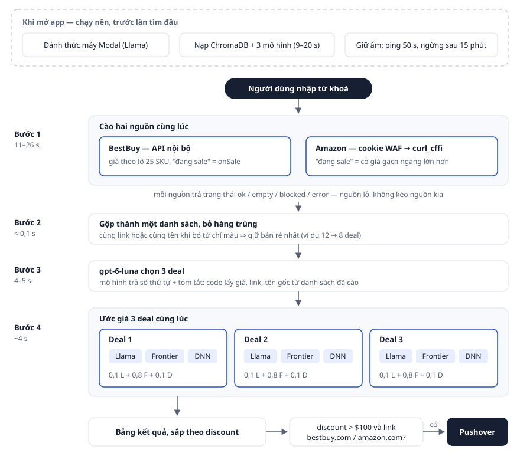
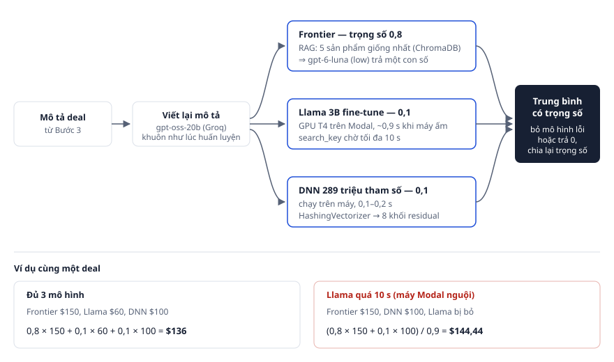
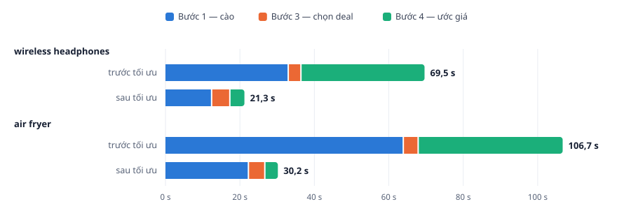

# Báo cáo: Hệ thống AI Price Intelligence — "The Price Is Right" (bản 3)

> **Mục đích:** Giải thích hệ thống tìm deal và ước lượng giá trị thật của sản phẩm sao cho người chưa biết gì về dự án, hoặc đã lâu không xem lại, chỉ cần đọc file này là hiểu.
> **Phạm vi:** Đồ án DACN3 — từ dữ liệu và mô hình đến hai ứng dụng đang chạy, kèm đợt tối ưu ngày 28–29/10/2026.

**Nhãn:** 29/10/2026 · segment4/ · search_key.py · price_is_right.py
**Thẻ giá:** Sony WH-1000XM5 — BestBuy | 228,00 | 313,92 | 85,92 | Một deal thật từ lượt đo ngày 29/10/2026, từ khoá "wireless headphones". Mô hình chỉ đọc mô tả, không nhìn giá bán.

## Phần 0: Đọc nhanh

> **Tóm tắt.** Hệ thống tìm sản phẩm đang giảm giá trên BestBuy và Amazon, rồi dùng AI đoán xem sản phẩm đó thật ra đáng giá bao nhiêu. Nếu giá bán thấp hơn nhiều so với giá AI đoán, đó là một deal tốt và hệ thống gửi thông báo lên điện thoại.

**Hệ thống làm gì.** Khi thấy một món hàng "đang giảm giá", người mua thường không biết mức giảm đó có thật không. Giá gạch ngang có thể bị đẩy lên cho đẹp. Hệ thống trả lời câu hỏi: *"Đọc mô tả này, món hàng đáng giá bao nhiêu?"* Sau đó nó so con số đó với giá bán. Phần chênh lệch gọi là **discount** (mức hời). Discount càng lớn thì deal càng tốt.

**Có hai ứng dụng.**

- **Ứng dụng 1 (`search_key.py`):** người dùng gõ một từ khoá, ví dụ "noise cancelling headphones". Hệ thống tìm hàng đang sale trên BestBuy và Amazon, chọn ra 3 deal, ước giá và hiện bảng kết quả.
- **Ứng dụng 2 (`price_is_right.py`):** tự chạy mỗi 5 phút. Nó đọc tin khuyến mãi của trang DealNews, chọn 5 deal, ước giá và tự báo khi gặp deal tốt.

**Kết quả chính.**

| Điều cần biết | Con số | Ghi chú |
|---|---|---|
| Sai số trung bình khi ước giá (cả hệ thống, lúc huấn luyện) | khoảng $30 mỗi sản phẩm | đo trên 200 sản phẩm chưa từng dùng để huấn luyện |
| Thời gian một lần tìm (ứng dụng 1) | 21–34 giây | trước đợt tối ưu: 70–107 giây |
| Tiền API mỗi lần tìm | khoảng 0,1 cent | ước từ số liệu đo, chưa tính GPU Modal |

**Đọc tiếp ở đâu.**

| Bạn muốn biết | Đọc |
|---|---|
| Các khái niệm AI dùng trong dự án | Phần 1 |
| Dữ liệu lấy từ đâu, vì sao chỉ có 8 nhóm hàng | Phần 2 |
| Đã thử những mô hình nào, vì sao chọn cách kết hợp 3 mô hình | Phần 3 |
| Hệ thống chạy thế nào từ lúc gõ từ khoá đến lúc ra kết quả | Phần 4 và 5 |
| Đã tối ưu những gì, nhanh hơn bao nhiêu | Phần 6 |
| Kết quả, chỗ còn yếu, nên thử từ khoá nào | Phần 7 và 8 |

---

## Phần 1: Kiến thức cần biết trước

> **Tóm tắt.** Tám khái niệm dưới đây xuất hiện khắp báo cáo. Mỗi khái niệm được giải thích bằng lời thường và một ví dụ ngay trong dự án.

### 1.1 Mô hình học máy ước giá

Một **mô hình học máy** là một chương trình tự rút ra quy luật từ rất nhiều ví dụ. Ở đây, mỗi ví dụ là một cặp: *mô tả sản phẩm* và *giá thật* của nó. Mô hình xem 800.000 cặp như vậy. Sau đó, khi được đưa một mô tả mới, nó đoán ra một con số giá.

Ví dụ: mô hình đã thấy hàng nghìn tai nghe chống ồn của Sony giá $250–$350. Gặp một tai nghe Sony chống ồn mới, nó sẽ đoán trong khoảng đó.

### 1.2 MAE — thước đo độ đúng

**MAE** (sai số tuyệt đối trung bình) cho biết mô hình đoán lệch trung bình bao nhiêu đô la. Món hàng giá thật $100, mô hình đoán $90, vậy là lệch $10. Lấy trung bình độ lệch trên nhiều sản phẩm thì ra MAE. **MAE càng thấp càng tốt.**

MAE luôn được đo trên **tập test**. Đó là các sản phẩm mô hình chưa từng thấy lúc học. Đo trên chính các sản phẩm đã dùng để học thì giống như cho học sinh làm lại đúng đề đã chữa, không nói lên điều gì.

### 1.3 Embedding — biến câu chữ thành dãy số

Máy tính không hiểu chữ, nó chỉ làm việc với số. Một **embedding** biến một câu thành một dãy số. Dự án dùng mô hình `all-MiniLM-L6-v2`, mỗi câu thành 384 số. Dãy số này gọi là **vector**.

Điểm quan trọng: hai câu có nghĩa giống nhau sẽ cho hai dãy số gần nhau. "Tai nghe chống ồn Sony" và "Sony noise cancelling headphones" sẽ nằm gần nhau. "Nồi chiên không dầu" thì nằm xa.

### 1.4 Cơ sở dữ liệu vector — tìm sản phẩm giống nhất

**ChromaDB** là một cơ sở dữ liệu chuyên lưu vector. Dự án lưu vector của 800.000 sản phẩm kèm giá thật của chúng. Khi cần ước giá một món hàng, hệ thống biến mô tả của nó thành vector rồi hỏi ChromaDB: "5 sản phẩm nào gần nhất?" Câu trả lời có trong chưa tới nửa giây.

### 1.5 LLM và mức suy luận

**LLM** (mô hình ngôn ngữ lớn) là loại AI đọc và viết văn bản, ví dụ GPT hay Llama. Dự án dùng **gpt-6-luna** của OpenAI. Đây là một mô hình rẻ và nhanh, được gọi qua mạng (API) và trả tiền theo lượng chữ.

Luna có thiết lập **mức suy luận** (`reasoning effort`). Mức `none` thì trả lời ngay. Mức `low` thì "nghĩ" một chút trước khi trả lời, chậm hơn và tốn hơn một ít. Mức cao hơn không chắc đã cho kết quả tốt hơn, nên dự án chọn mức bằng cách đo.

### 1.6 RAG — tra cứu rồi mới trả lời

**RAG** (tra cứu rồi sinh câu trả lời) là cách giúp LLM trả lời có căn cứ. Thay vì hỏi thẳng "món này giá bao nhiêu?", hệ thống làm hai bước:

1. Tra ChromaDB để lấy 5 sản phẩm giống nhất kèm giá thật của chúng.
2. Đưa cả 5 sản phẩm đó vào câu hỏi gửi LLM: "Đây là vài món tương tự và giá của chúng. Món này giá bao nhiêu?"

Giống như một người định giá nhìn vài món đã bán gần đây trước khi ra giá.

### 1.7 Fine-tune và QLoRA — dạy thêm cho một mô hình có sẵn

**Fine-tune** là lấy một LLM có sẵn rồi cho nó học thêm trên dữ liệu riêng. Dự án lấy **Llama-3.2-3B** (một LLM nhỏ của Meta) và dạy nó đúng một việc: đọc mô tả, trả lời giá.

Dạy lại toàn bộ mô hình thì rất tốn GPU, nên dự án dùng **QLoRA**. Mô hình gốc được nén nhỏ (lượng tử hoá 4-bit) và giữ nguyên, chỉ một phần gắn thêm rất nhỏ được học, gọi là **adapter**. Toàn bộ "kiến thức mới" nằm trong một file adapter khoảng 73 MB.

### 1.8 Ensemble — kết hợp nhiều mô hình

**Ensemble** là cho nhiều mô hình cùng đoán, rồi lấy trung bình có trọng số. Mỗi mô hình sai theo một kiểu khác nhau, nên khi cộng lại, các sai lệch ngược chiều triệt tiêu bớt nhau. Kết quả thường tốt hơn từng mô hình riêng lẻ. Hệ thống này kết hợp 3 mô hình (Phần 3).

---

## Phần 2: Bài toán và dữ liệu

> **Tóm tắt.** Dữ liệu huấn luyện là 820.000 sản phẩm Amazon thuộc 8 nhóm hàng, giá từ $0,5 đến $999,49. Giới hạn này quyết định hệ thống ước giá tốt cho loại hàng nào và kém cho loại nào.

### 2.1 Thế nào là một deal tốt

Mô hình **chỉ đọc mô tả sản phẩm**, không được nhìn giá bán. Nếu nhìn thấy giá bán, nó sẽ có xu hướng đoán gần con số đó, và phép so sánh mất ý nghĩa. Hệ thống tính `discount = giá ước − giá bán`. Ứng dụng 1 gửi thông báo khi discount lớn hơn $100, ứng dụng 2 khi lớn hơn $50.

### 2.2 Dữ liệu lấy từ đâu

Dữ liệu là bộ **Amazon Reviews 2023** công khai của nhóm McAuley-Lab. Dự án lấy **8 nhóm hàng**: Automotive (ô tô), Electronics (điện tử), Office Products (văn phòng), Tools & Home Improvement (dụng cụ), Cell Phones & Accessories (điện thoại và phụ kiện), Toys & Games (đồ chơi), Appliances (thiết bị gia dụng), Musical Instruments (nhạc cụ).

Dữ liệu được làm sạch qua bốn bước:

1. **Bỏ hàng trùng:** khoảng 2,93 triệu sản phẩm, bỏ trùng còn khoảng 2,89 triệu.
2. **Lọc:** chỉ giữ hàng giá từ $0,5 đến $999,49 và có mô tả dài ít nhất 600 ký tự. Hàng trên $1.000 thường là đồ công nghiệp hoặc xa xỉ, quá ít mẫu để học. Mô tả quá ngắn thì không đủ thông tin để đoán giá.
3. **Lấy mẫu có chủ đích:** dữ liệu gốc có rất nhiều phụ tùng ô tô giá rẻ. Lấy ngẫu nhiên thì mô hình sẽ quen đoán thấp. Dự án ưu tiên hàng đắt hơn (xác suất được chọn tỉ lệ với bình phương giá) và giảm mạnh tỉ lệ nhóm Automotive. Kết quả là 820.000 sản phẩm, giá trung bình tăng từ khoảng $59 lên khoảng $140.
4. **Viết lại mô tả bằng LLM:** mô tả gốc rất lộn xộn (mã linh kiện, quảng cáo, thông số rời rạc). Mỗi sản phẩm được viết lại theo một khuôn cố định gồm năm dòng: Title, Category, Brand, Description, Details. Việc này dùng mô hình gpt-oss-20b trên Groq, chạy theo lô (batch), tốn khoảng $30.

Cuối cùng chia thành 800.000 sản phẩm để học, 10.000 để kiểm tra khi học và 10.000 để test. Bộ dữ liệu đã đưa lên HuggingFace với tên `SeanSunny/items_full`.

### 2.3 Hệ quả của dữ liệu lên cách dùng

Vì dữ liệu chỉ có 8 nhóm hàng và giá dưới $999, hệ thống ước tốt nhất cho hàng điện tử, nhạc cụ, dụng cụ tầm giá $50–$500. Nó **kém** ở ba trường hợp:

- **Hàng đắt hơn $999** (laptop cao cấp, TV lớn): mô hình gần như chưa từng thấy mức giá đó, nên có xu hướng đoán thấp.
- **Nhóm hàng không có trong dữ liệu**, ví dụ đồ bếp như nồi chiên không dầu: khi tra ChromaDB, hệ thống kéo về những sản phẩm sai loại.
- **Hàng rất rẻ** (ốp điện thoại, tai nghe $20): giá đúng hay sai cũng hiếm khi tạo ra discount trên $100.

Danh sách từ khoá nên thử nằm ở Phần 8.

<details markdown="1">
<summary>Trong code</summary>

- Xử lý dữ liệu: `scraping_data_tv/Data_processing_for_English_data/Report_data_processing_v2.md` (Day 1–2), các file trong `Code_Data_processing/pricer/`: `parser.py`, `items.py`, `batch.py`.
- Ngưỡng lọc: `MIN_PRICE = 0.5`, `MAX_PRICE = 999.49`, `MIN_CHARS = 600` trong `Code_Data_processing/pricer/parser.py`.
- Bộ dữ liệu: HuggingFace `SeanSunny/items_full` (820.000), `SeanSunny/items_lite` (22.000).

</details>

---

## Phần 3: Mô hình ước giá

> **Tóm tắt.** Dự án đã thử từ cách đoán đơn giản nhất đến LLM và mô hình tự huấn luyện. Kết hợp 3 mô hình cho sai số thấp nhất, khoảng $30 mỗi sản phẩm, nên hệ thống dùng cách kết hợp này.

### 3.1 Đã thử những gì

Bảng dưới là sai số trên cùng 200 sản phẩm test (lấy từ các báo cáo lúc huấn luyện):

| Cách ước giá | MAE | Nói ngắn |
|---|---|---|
| Đoán bừa | $382 | mốc dưới cùng |
| Luôn đoán giá trung bình | $106 | mốc không dùng mô hình |
| XGBoost, một mô hình học máy truyền thống | $68 | tốt nhất trong nhóm truyền thống |
| Claude Opus 4.5, hỏi thẳng không cho học thêm | $47 | LLM mạnh nhưng không biết dữ liệu này |
| Mạng nơ-ron sâu (DNN) tự huấn luyện | $46 | chạy ngay trên máy, rất nhanh |
| GPT-5.1 kèm RAG | $44 | biết kiến thức chung, có 5 sản phẩm tham khảo |
| Llama-3.2-3B fine-tune bằng QLoRA | $40 | học đúng dữ liệu giá này |
| **Kết hợp 3 mô hình (ensemble)** | **$30** | **dùng trong hệ thống** |

### 3.2 Ba mô hình được kết hợp

| Mô hình | Trọng số | Mạnh ở đâu |
|---|---|---|
| **Frontier**: LLM kèm RAG | 80 % | biết kiến thức chung về hàng hoá, lại có 5 sản phẩm tương tự để so |
| **Specialist**: Llama fine-tune | 10 % | đã học thói quen giá của chính bộ dữ liệu này |
| **DNN**: mạng nơ-ron sâu | 10 % | nắm chắc các từ khoá gắn với giá (hãng, dòng sản phẩm) |

Công thức là `giá = 0,8 × Frontier + 0,1 × Specialist + 0,1 × DNN`. Frontier được trọng số lớn nhất vì nó đúng nhất khi đứng riêng. Hai mô hình còn lại kéo kết quả lại mỗi khi Frontier đoán lệch xa.

Hai chi tiết đáng nhớ:

- **Llama đoán giá như chọn đáp án.** Bộ tách chữ (tokenizer) của Llama coi mỗi số từ 0 đến 999 là đúng một "từ". Vì vậy đoán giá với Llama giống như chọn 1 trong khoảng 1.000 đáp án, dễ học hơn việc ghép từng chữ số.
- **DNN đọc theo từ khoá.** Nó biến mô tả thành 5.000 ô đánh dấu "có hoặc không có từ này" (kỹ thuật HashingVectorizer), rồi đưa qua một mạng 8 khối, tổng cộng 289 triệu tham số. Nó mạnh vì dữ liệu đã được viết lại theo khuôn, hãng và nhóm hàng luôn ghi rõ.

<details markdown="1">
<summary>Trong code</summary>

- `segment4/price_agents/ensemble_agent.py` — kết hợp 3 mô hình (`WEIGHTS`, `combine`).
- `segment4/price_agents/frontier_agent.py`, `specialist_agent.py`, `neural_network_agent.py`, `deep_neural_network.py`.
- Chi tiết huấn luyện: `Report_data_processing_v2.md` (DNN), `report_fine_tune_llm.md` (Llama QLoRA).

</details>

---

## Phần 4: Hệ thống tổng thể

> **Tóm tắt.** Code chia thành ba tầng: giao diện, khung điều phối, và các "agent". Mỗi agent làm đúng một việc. Một lần tìm đi qua bốn bước: lấy dữ liệu, gộp, chọn deal, ước giá.

### 4.1 Ba tầng

| Tầng | Gồm | Làm gì |
|---|---|---|
| Giao diện | `search_key.py`, `price_is_right.py` | trang web (Gradio) để gõ từ khoá, xem bảng và log |
| Khung điều phối | `multi_source_framework.py`, `deal_agent_framework.py` | mở ChromaDB, nạp các mô hình một lần, giữ kết quả |
| Agent | thư mục `price_agents/`, `bestbuy_untils/` | mỗi agent một việc: lấy dữ liệu, chọn deal, ước giá, viết tin nhắn, điều phối |

**Agent** ở đây chỉ là một lớp Python làm một việc rõ ràng và tự ghi log. Thứ tự các bước do code viết sẵn, không để LLM tự quyết. Lý do: các bước luôn cố định, để LLM tự quyết chỉ làm chậm và khó đoán hơn.

### 4.2 Một lần tìm diễn ra thế nào



Kể theo thứ tự:

1. **Khi vừa mở ứng dụng**, hệ thống chạy ngầm ba việc: đánh thức máy chủ chạy Llama, nạp ChromaDB cùng các mô hình, và bắt đầu "giữ ấm" máy chủ đó (mục 5.5). Nhờ vậy lần tìm đầu tiên không phải chờ thêm.
2. **Bước 1, lấy dữ liệu:** hệ thống tìm trên BestBuy và Amazon **cùng lúc**, mỗi bên lấy tối đa vài sản phẩm đang sale. Mỗi bên báo lại một trạng thái: có hàng, không có hàng, bị chặn, hoặc lỗi. Một bên hỏng không làm hỏng bên kia.
3. **Bước 2, gộp:** hai danh sách thành một, bỏ các sản phẩm trùng.
4. **Bước 3, chọn deal:** gpt-6-luna chọn ra 3 deal và viết tóm tắt cho từng deal.
5. **Bước 4, ước giá:** 3 deal được ước giá **cùng lúc**. Trong mỗi deal, 3 mô hình cũng chạy cùng lúc.
6. **Kết quả:** bảng sắp theo discount. Nếu deal tốt nhất có discount trên $100 và link đúng là của BestBuy hoặc Amazon, hệ thống gửi thông báo lên điện thoại.

### 4.3 Mỗi phần chạy ở đâu

| Thành phần | Chạy ở | Vì sao |
|---|---|---|
| gpt-6-luna (chọn deal, Frontier, viết tin nhắn) | máy chủ OpenAI, gọi qua mạng | LLM lớn, trả tiền theo lượng chữ, rất rẻ |
| gpt-oss-20b (viết lại mô tả) | máy chủ Groq, gọi qua mạng | rất nhanh, dưới 1 giây mỗi lần |
| Llama-3.2-3B fine-tune | GPU thuê trên Modal | theo thiết kế của khoá học; Modal chỉ tính tiền khi máy đang bật |
| DNN, bộ tạo embedding, ChromaDB | máy tính của người dùng | nhỏ và nhanh, dưới nửa giây |

<details markdown="1">
<summary>Trong code</summary>

- Điều phối 4 bước: `segment4/price_agents/multi_source_planning_agent.py` — `search_and_scrape`, `combine`, `select_top_deals`, `estimate_prices`, `plan`.
- Lớp cơ sở của mọi agent: `segment4/price_agents/agent.py`.
- Ứng dụng 2 dùng `segment4/price_agents/planning_agent.py`.

</details>

---

## Phần 5: Từng khâu

### 5.1 Lấy dữ liệu từ BestBuy và Amazon

> **Tóm tắt.** Cả hai trang đều chặn chương trình tự động. Với BestBuy, hệ thống gọi thẳng các "cửa sau" dữ liệu (API) mà chính trang web dùng. Với Amazon, hệ thống dùng một trình duyệt thật để "xin vé vào cửa", rồi dùng vé đó cho các lần tải sau.

**BestBuy.** Trang sản phẩm của BestBuy chặn yêu cầu đến từ máy của dự án. Nhưng bản thân trang web BestBuy lấy giá và thông tin qua các **API**, tức các địa chỉ trả về dữ liệu dạng bảng thay vì trang web. Các địa chỉ này thì không bị chặn. Hệ thống làm bốn việc:

1. Mở trang tìm kiếm và lấy danh sách mã sản phẩm (SKU), giữ đúng thứ tự BestBuy xếp (liên quan nhất đứng trước).
2. Hỏi API giá cho từng nhóm 25 mã. Mỗi sản phẩm có trạng thái giá, và **"đang sale" nghĩa là trạng thái `onSale`**.
3. Với mỗi sản phẩm đang sale, hỏi thêm API chi tiết để lấy danh sách tính năng và link chuẩn.
4. Đủ số deal cần thì dừng, không hỏi tiếp.

Để không bị nhận ra là chương trình, mọi yêu cầu đi qua thư viện **curl_cffi**. Thư viện này giả "dấu vân tay" kết nối giống hệt trình duyệt Chrome.

**Amazon.** Amazon có một lớp chặn mạnh hơn tên là **AWS WAF** (tường lửa của Amazon). Khi một chương trình mở amazon.com, Amazon không trả trang ngay. Nó gửi một đoạn mã nhỏ bắt máy kia chạy thử. Trình duyệt thật chạy được đoạn mã đó, còn curl_cffi thì không, nên bị chặn.

Vì vậy hệ thống làm theo cách **lai**, gồm hai bước:

1. Mở một **trình duyệt chạy ngầm** (Chromium, điều khiển bằng thư viện Playwright), vào trang chủ Amazon và để nó chạy đoạn mã kiểm tra. Amazon trả về một **cookie**, có thể hiểu là tấm vé chứng nhận "đã kiểm tra". Việc này mất vài giây, xong thì đóng trình duyệt.
2. Đưa tấm vé cho curl_cffi. Từ đây curl_cffi tìm kiếm và mở trang chi tiết sản phẩm rất nhanh. Hệ thống còn gửi kèm một cookie ép Amazon hiện giá bằng đô la.


Ở Amazon, **"đang sale" nghĩa là sản phẩm có giá gạch ngang cao hơn giá đang bán.**

**Vì sao chọn cách lai.** Dùng trình duyệt thật cho mọi bước thì chắc chắn qua được, nhưng chậm và tốn bộ nhớ. Cách lai chỉ dùng trình duyệt một lần mỗi lượt tìm, phần còn lại nhanh như tải trang bình thường.

| Cách đã thử (28/10) | Kết quả | Thời gian mỗi lần tìm |
|---|---|---|
| Chỉ dùng curl_cffi, thử 6 kiểu giả trình duyệt | bị chặn | — |
| Trình duyệt thật vào thẳng trang tìm kiếm | bị chặn | — |
| Trình duyệt thật gõ vào ô tìm kiếm | qua được | 6,3 giây, phải giữ trình duyệt mở |
| **Cách lai (đang dùng)** | **qua được** | **1,3–1,8 giây**, cộng vài giây lấy cookie |

**Những lần từng hỏng và cách đã sửa.**

- **Giá hiện bằng tiền Việt.** Máy đặt ở Việt Nam nên Amazon tự đổi sang VND, và code cũ đọc nhầm số VND thành đô la. Giờ hệ thống ép hiển thị đô la, và bỏ qua mọi giá không có ký hiệu "$".
- **BestBuy chỉ trả 25 sản phẩm mỗi lần hỏi giá.** Code cũ hỏi một lần cho hơn 200 mã, nên chỉ 25 mã được kiểm giá và bỏ sót nhiều deal. Giờ hỏi theo từng nhóm 25.
- **Trang "Continue shopping" của Amazon (29/10).** Sau khi qua lớp kiểm tra, Amazon có lúc hiện một trang trung gian không có ô tìm kiếm. Code cũ chờ ô tìm kiếm tới 20 giây, rồi báo lỗi và bỏ luôn cookie đã có. Giờ chỉ chờ tối đa 3 giây rồi dùng cookie đang có.
- **Trang trắng (chặn mềm).** Đôi khi Amazon trả một trang trông bình thường nhưng không có sản phẩm nào. Hệ thống nghỉ 2 giây, xin cookie mới và thử lại một lần.

**Giới hạn còn lại.** Amazon có thể đổi lớp chặn bất kỳ lúc nào. Gửi yêu cầu dồn dập thì bị chặn tạm thời, nên khi thử nghiệm phải để thưa ra. 6 trang chi tiết Amazon vẫn mở lần lượt, đây là chỗ chậm nhất còn lại (mục 6.3).

<details markdown="1">
<summary>Trong code</summary>

- BestBuy: `segment4/price_agents/bestbuy_deals.py` — `_init_session`, `search_bestbuy`, `get_price_blocks` (nhóm 25 mã, `PRICE_BLOCKS_BATCH_SIZE`), `get_product_details`, `search_filter_scrape_bestbuy`.
- Amazon: `segment4/price_agents/amazon_deals.py` — `_get_waf_cookies` (trình duyệt ngầm, chờ ô tìm kiếm tối đa `WAIT_SEARCH_BOX_MS = 3000`), `init_amazon_session` (cookie `i18n-prefs=USD`), `search_amazon` (link `/s?k=…&ref=nb_sb_noss` kèm header `Referer`; bị chặn thì ném `AmazonBlockedError`), `scrape_product_page`, `search_filter_scrape_amazon` (thử lại một lần).
- Trạng thái từng nguồn: `_run_source` trong `multi_source_planning_agent.py`.

</details>

### 5.2 Chọn deal bằng LLM

> **Tóm tắt.** Từ khoảng 8–12 sản phẩm của hai trang, gpt-6-luna chọn 3 deal và viết tóm tắt. Mô hình chỉ chọn số thứ tự. Giá và link do code lấy từ dữ liệu đã cào, nên mô hình không thể ghi sai.

Bước này cần một LLM vì nó phải đọc mô tả và tóm tắt lại thành câu gọn, để ensemble ở bước sau đọc được. Hệ thống làm bốn việc:

1. **Bỏ hàng trùng.** BestBuy hay liệt kê mỗi màu của cùng một mẫu thành một sản phẩm riêng, cùng link nhưng giá khác nhau. Hệ thống gộp các bản trùng (cùng link, hoặc cùng tên khi bỏ chữ chỉ màu) và giữ bản rẻ nhất. Ví dụ ngày 29/10: 5 màu tai nghe Sony WH-1000XM5 có giá từ $228 đến $298, được gộp lại còn bản $228.
2. **Đánh số.** Mỗi sản phẩm được đánh số "Deal 1", "Deal 2"… trong câu hỏi gửi luna.
3. **Luna trả lời theo khuôn cố định.** Kỹ thuật này gọi là **structured output**: thay vì viết văn tự do, luna phải trả về đúng hai trường là số thứ tự của deal và câu tóm tắt.
4. **Code ghép kết quả.** Code lấy giá, link và tên gốc của sản phẩm theo số thứ tự đó, rồi ghép thành mô tả "[Nguồn] tên gốc. tóm tắt của luna". Số thứ tự không hợp lệ hoặc bị lặp thì bỏ qua. Tối đa giữ 3 deal.

**Vì sao làm như vậy.** Bản cũ để mô hình tự chép lại giá và link vào câu trả lời, nên có thể chép sai. Một lần đo, bản cũ còn trả về 8 deal dù đã được dặn chọn tối đa 3. Nguyên tắc mới: **mô hình chỉ chọn, code giữ con số.**

Tên gốc được ghép vào đầu mô tả vì luna có lúc tóm tắt mà quên tên hãng. Ví dụ: "This 6-quart air fryer…" không còn chữ "Ninja". Thiếu tên hãng, ensemble đoán một nồi chiên Ninja $229,99 chỉ còn $167, trong khi lượt có tên đoán $212.

Mức suy luận được chọn bằng cách đo trên cùng một danh sách deal, mỗi cấu hình 3 lần:

| Cấu hình | Thời gian | Số lần chọn đủ 3 deal khác nhau | Sai giá hoặc link |
|---|---|---|---|
| gpt-5-nano (bản cũ) | 3,3–4,4 giây | 5 / 6 | có thể, vì mô hình tự chép |
| **gpt-6-luna, `none` (đang dùng)** | **4,2–4,3 giây** | **6 / 6** | **0** |
| gpt-6-luna, `low` | 4,6–5,3 giây | 6 / 6 | 0 |

**Giới hạn còn lại.** Luna đang chọn theo tiêu chí "mô tả rõ ràng, giá rõ ràng", **chưa phải "giảm nhiều nhất"**. Cũng chưa có phép so với một luật đơn giản không dùng AI (ví dụ "lấy 3 deal giảm nhiều nhất") để chứng minh dùng LLM ở bước này là đáng.

<details markdown="1">
<summary>Trong code</summary>

- `segment4/bestbuy_untils/multi_source_scanner_agent.py` — `MODEL = "gpt-6-luna"`, `REASONING_EFFORT = "none"`, `dedupe_deals`, khuôn trả lời `PickedDeals` (`deal_number`, `product_description`), `scan`.
- `segment4/bestbuy_untils/unified_deal.py` — gộp dữ liệu hai nguồn về một dạng (`UnifiedScrapedDeal`).

</details>

### 5.3 Ước giá

> **Tóm tắt.** Mỗi deal được viết lại mô tả cho đúng khuôn lúc huấn luyện, rồi 3 mô hình cùng đoán giá và hệ thống lấy trung bình có trọng số. Mô hình nào lỗi thì bị bỏ, phần trọng số của nó chia cho các mô hình còn lại.



Một deal đi qua ba bước:

1. **Viết lại mô tả.** gpt-oss-20b viết lại mô tả theo khuôn năm dòng Title, Category, Brand, Description, Details, giống hệt dữ liệu lúc huấn luyện. Mô hình đọc đầu vào quen thuộc thì đoán chính xác hơn. Nếu bước này lỗi, hệ thống dùng mô tả gốc.
2. **Ba mô hình cùng đoán.** Frontier tra ChromaDB lấy 5 sản phẩm giống nhất rồi hỏi gpt-6-luna (RAG, mục 1.6). Specialist gửi mô tả lên Llama trên Modal. DNN tính ngay trên máy. Ba việc chạy cùng lúc nên thời gian chỉ bằng việc chậm nhất.
3. **Kết hợp.** Hệ thống lấy trung bình có trọng số, chỉ tính các mô hình trả về giá lớn hơn 0.

**Vì sao coi giá 0 là lỗi.** Frontier và Llama trả về 0 khi không đọc ra được con số nào trong câu trả lời. Trước đây số 0 được tính thẳng vào trung bình, kéo kết quả xuống còn khoảng 20 % giá thật mà không ai biết. Giờ số 0 bị loại.

**Frontier đổi từ GPT-5.1 sang gpt-6-luna (29/10).** Trước khi đổi, dự án đo 4 cấu hình trên cùng 200 sản phẩm test, mỗi cấu hình 1 lần:

| Cấu hình Frontier | MAE | Tiền cho 200 lần gọi |
|---|---|---|
| GPT-5.1, `none` (bản cũ) | $31,16 | $0,179 |
| gpt-6-luna, `none` | $31,42 | $0,013 |
| **gpt-6-luna, `low` (đang dùng)** | **$29,69** | **$0,018** |
| gpt-6.1-terra, `none` | $28,51 | $0,130 |

Các mức chênh này đều nhỏ. Với 200 sản phẩm và 1 lần đo, **không kết luận được cấu hình nào thật sự tốt hơn**, chỉ chắc là cấu hình mới không kém GPT-5.1. Dự án chọn luna `low` vì rẻ hơn GPT-5.1 khoảng 10 lần, rẻ hơn terra khoảng 7 lần, và cả hệ thống dùng chung một mô hình.

Lưu ý: MAE của Frontier ở bảng này (khoảng $31) thấp hơn con số $44 ở mục 3.1. Hai lần đo dùng cách đánh giá khác nhau. Phép so ở bảng này là công bằng vì cả 4 cấu hình chạy trên cùng 200 sản phẩm.

**Giới hạn còn lại.** Llama hay trả lặp lại vài con số ($60, $220, $350…) cho các sản phẩm khác nhau. Điều này đã thấy trong log nhưng chưa tìm ra nguyên nhân. Khi máy chủ Modal đang tắt, Llama cần 32–46 giây để khởi động, nên ứng dụng 1 chỉ chờ tối đa 10 giây rồi bỏ qua Llama ở lượt đó (mục 5.5).

<details markdown="1">
<summary>Trong code</summary>

- `segment4/price_agents/ensemble_agent.py` — `price` (3 mô hình chạy song song), `_safe_price` (mô hình lỗi trả `None`), `combine` (bỏ giá 0, chia lại trọng số).
- `segment4/price_agents/frontier_agent.py` — `MODEL = "gpt-6-luna"`, `REASONING_EFFORT = "low"`, `find_similars` (tra ChromaDB).
- `segment4/price_agents/preprocessor.py` — viết lại mô tả; mô hình đặt bằng biến `PRICER_PREPROCESSOR_MODEL` trong `.env`.
- Đo MAE Frontier: `scripts/do_luong/eval_frontier.py`.

</details>

### 5.4 Thông báo

> **Tóm tắt.** Khi deal tốt nhất có discount vượt ngưỡng, luna viết vài câu vui và hệ thống gửi lên điện thoại qua Pushover. Chỉ gửi khi link đúng là của BestBuy hoặc Amazon.

**Pushover** là một dịch vụ gửi thông báo đẩy (push notification) tới điện thoại. Khi deal tốt nhất vượt ngưỡng ($100 ở ứng dụng 1, $50 ở ứng dụng 2), gpt-6-luna viết 2–3 câu giới thiệu deal và hệ thống gửi kèm link. Giao diện cũng có nút để gửi tay một deal bất kỳ.

**Vì sao phải kiểm link.** Chữ trên trang bán hàng là dữ liệu không đáng tin, mà chữ đó lại được đưa vào câu hỏi gửi LLM. Trong khi đó, ứng dụng có đường gửi tin ra ngoài tới điện thoại. Ghép hai điều này lại, về lý thuyết, một trang bán hàng có thể "dụ" hệ thống gửi một link lạ cho người dùng. Vì vậy hệ thống chỉ gửi khi link thuộc `bestbuy.com` hoặc `amazon.com`. Link vốn do code tự dựng, nên đây là lớp kiểm thêm cho chắc.

**Gửi lỗi không làm mất kết quả.** Nếu Pushover không phản hồi trong 15 giây hoặc báo lỗi, hệ thống ghi lại lỗi và bảng kết quả vẫn hiện bình thường.

**Giới hạn còn lại.** Thông báo chỉ đúng khi giá ước đúng. Hiện chưa đếm được hệ thống báo nhầm bao nhiêu lần và bỏ lỡ bao nhiêu deal tốt.

<details markdown="1">
<summary>Trong code</summary>

- `segment4/price_agents/messaging_agent.py` — `craft_message` (gpt-6-luna qua thư viện LiteLLM), `push` (giới hạn chờ 15 giây, báo lỗi khi Pushover trả mã khác 200), `notify`.
- Kiểm link: `is_store_url` trong `multi_source_planning_agent.py`; nút gửi tay: `send_notification` trong `multi_source_framework.py`.

</details>

### 5.5 Giao diện, nạp mô hình và giữ ấm máy chủ

> **Tóm tắt.** Khi vừa mở ứng dụng, hệ thống nạp sẵn mô hình và đánh thức máy chủ chạy Llama. Trong lúc có người dùng, nó giữ máy chủ không tắt. Lần tìm đầu tiên vì vậy không phải chờ.

**Vấn đề.** Llama chạy trên **Modal**, một dịch vụ cho thuê GPU theo giây. Để đỡ tốn tiền, Modal tự tắt máy sau 60 giây không có việc. Lần gọi sau đó phải chờ máy bật lại và nạp Llama, mất 32–46 giây. Hiện tượng này gọi là **khởi động nguội (cold start)**. Trước đợt tối ưu, gần như lần tìm nào cũng bị chờ như vậy.

**Cách xử lý.**

1. **Lúc mở ứng dụng**, hệ thống gửi một lệnh đánh thức máy Modal, đồng thời nạp ChromaDB và các mô hình (9–20 giây) trong lúc người dùng còn đang gõ từ khoá.
2. **Giữ ấm:** cứ 50 giây hệ thống gọi nhẹ máy Modal một lần để máy không tắt. Nếu 15 phút không có lần tìm nào thì ngừng gọi. Có lần tìm mới thì tự bật lại. Tắt ứng dụng là ngừng hẳn.
3. **Chờ có giới hạn:** ứng dụng 1 chỉ chờ Llama tối đa 10 giây. Quá thời gian thì bỏ Llama ở deal đó và tính giá bằng hai mô hình còn lại.
4. **Báo trạng thái:** ô Status trên giao diện hiện trạng thái từng nguồn, ví dụ "BestBuy: ok (6), Amazon: ok (6)". Nếu pipeline lỗi, ô này báo lỗi. Trước đây giao diện bị treo ở chữ "Processing..." mãi.

**Vì sao không bảo Modal tự giữ máy lâu hơn.** Đó là cách tốt hơn, nhưng Modal không cho tạo ứng dụng GPU mới khi tài khoản chưa gắn thẻ thanh toán (29/10). Vì vậy hệ thống giữ ấm từ phía ứng dụng.

**Chi phí.** Modal tính tiền theo thời gian máy GPU còn bật, kể cả lúc máy rảnh. Giữ ấm tốn khoảng $0,59 mỗi giờ, và chỉ tốn trong lúc ứng dụng đang mở và có người tìm trong 15 phút gần nhất. Mở ứng dụng mà không tìm gì thì tốn tối đa khoảng $0,16.

**Giới hạn còn lại.** Nếu bấm tìm ngay khi vừa mở ứng dụng (chưa tới khoảng 40 giây), máy Modal chưa bật xong và lượt đầu sẽ thiếu Llama. Ứng dụng 2 không giữ ấm, nên mỗi lần quét đầu tiên vẫn phải chờ máy bật (giữ nguyên hành vi cũ).

<details markdown="1">
<summary>Trong code</summary>

- `segment4/search_key.py` — `App.preload` (chạy ngầm khi mở ứng dụng), `App._run_pipeline` (lỗi hiện ở ô Status).
- `segment4/price_agents/specialist_agent.py` — `wake_up_modal`, `start_keep_warm`, `PING_SECONDS = 50`, `KEEP_WARM_IDLE_STOP = 900`, `COLD_SKIP_SECONDS = 45`; giới hạn chờ đặt bằng `SPECIALIST_TIMEOUT_SECONDS = 10` trong `multi_source_planning_agent.py` (ứng dụng 2 không đặt, nên chờ như cũ).

</details>

---

## Phần 6: Đợt tối ưu 28–29/10/2026

> **Tóm tắt.** Một lần tìm từ 70–107 giây còn 21–34 giây, chất lượng giá ước không đổi. Ba chỗ cắt được nhiều thời gian nhất: cookie Amazon không còn chờ vô ích, máy Llama được giữ ấm, và bước ước giá chạy song song.

### 6.1 Cách làm

Đợt tối ưu đi theo năm nguyên tắc:

1. **Đo trước khi sửa.** Một script đo thời gian của từng hàm trong pipeline mà không cần sửa code. Khi đo, thông báo Pushover bị chặn để không gửi tin thật.
2. **Sửa từng thứ một.** Mỗi thay đổi là một commit riêng. Mốc để quay lại bản cũ là tag `moc-truoc-toi-uu-2026-10-29`.
3. **Kiểm lại sau mỗi bước** trên cùng 2 từ khoá, xem có làm hỏng chỗ đang chạy tốt không. Phải đạt cả năm điều: không lỗi, cả hai nguồn có hàng, ra 3 deal khác nhau, giá là đô la và lớn hơn 0, giá ước gần với lượt đo cũ.
4. **Cố định đầu vào khi so mô hình.** Giá trên web thay đổi từng phút. Vì vậy hệ thống cào dữ liệu một lần, lưu lại, rồi so mọi cấu hình trên cùng danh sách đó.
5. **Nhờ người đọc độc lập.** Một agent AI mới, không biết gì về quá trình sửa, đọc toàn bộ thay đổi. Nó tìm ra 3 lỗi thật mà các lượt đo đã bỏ sót (mục 6.4). Cả 3 đã được sửa và thử lại.

### 6.2 Trước và sau



| Chỗ | Trước | Sau | Nguyên nhân và cách sửa |
|---|---|---|---|
| Lấy cookie Amazon | 22–44 giây | khoảng 5 giây | chờ ô tìm kiếm 20 giây trên trang "Continue shopping" rồi bỏ cookie; giờ chờ tối đa 3 giây và dùng cookie có sẵn |
| Lần tìm đầu tiên | thêm khoảng 22 giây để nạp mô hình | không thêm | trước đây nạp ở lần bấm đầu; giờ nạp ngầm khi mở ứng dụng |
| Llama trên Modal | 31,5–46 giây khi máy đã tắt | khoảng 0,9 giây khi máy ấm | máy tự tắt sau 60 giây; giờ đánh thức, giữ ấm và giới hạn thời gian chờ |
| Bước 4 (ước giá 3 deal) | 33–40 giây | khoảng 4 giây | trước đây làm lần lượt; giờ chạy song song hai tầng |
| Bước 3 (chọn deal) | 3,3–4,4 giây, có lần trả 8 deal | 3,7–5,1 giây, luôn tối đa 3 deal | đổi sang luna, chọn theo số thứ tự |
| **Cả một lần tìm** | **69,5 giây** (wireless headphones), **106,7 giây** (air fryer) | **21,3 giây** và **30,2 giây** | người dùng chạy thật với từ khoá "laptop": 27,1 giây |

### 6.3 Chạy song song — vì sao an toàn

Hầu hết thời gian của pipeline là **chờ mạng**: chờ OpenAI, Groq, Modal, BestBuy, Amazon trả lời. Phần tính toán trên máy rất ngắn. Vì vậy hệ thống dùng **luồng (thread)**: trong lúc một việc đang chờ mạng, việc khác chạy tiếp. Cách này đơn giản, không phải viết lại code theo kiểu khác.

Chạy song song thì phải cẩn thận ở những chỗ dùng chung tài nguyên:

- **Mô hình trên GPU của máy** (DNN, bộ tạo embedding kèm ChromaDB) được cho chạy lần lượt, vì nhiều luồng cùng dùng một mô hình GPU dễ gây lỗi. Mỗi lần chỉ mất dưới nửa giây nên gần như không làm chậm.
- **Các lần gọi Llama xếp hàng.** Nếu gọi cùng lúc, Modal có thể bật thêm máy mới, mỗi máy lại phải khởi động nguội, vừa tốn tiền vừa không nhanh hơn. Máy ấm chỉ mất khoảng 0,9 giây mỗi lần, nên 3 deal xếp hàng vẫn nhanh.
- **Cố ý chưa song song:** 6 trang chi tiết Amazon vẫn mở lần lượt, vì gửi dồn dập dễ bị chặn. Đây là chỗ chậm nhất còn lại, khoảng 13–19 giây.

### 6.4 Đã thử nhưng không dùng

| Phương án | Kết quả | Vì sao không dùng |
|---|---|---|
| Ứng dụng Modal mới, tự giữ máy 10 phút, tối đa 1 máy | chưa chạy được | Modal từ chối tạo ứng dụng GPU mới khi chưa gắn thẻ |
| gpt-6-luna `low` cho bước chọn deal | chậm hơn, chất lượng như nhau | mức `none` nhanh hơn |
| gpt-6.1-terra cho Frontier | MAE $28,51 | không phân biệt được với luna `low`, đắt hơn khoảng 7 lần |
| gpt-6-luna `none` cho Frontier | MAE $31,42 | luna `low` sát hơn một chút, tiền chênh rất nhỏ |

Ba lỗi người đọc độc lập tìm ra (đã sửa):

1. Khi máy Modal đang tắt và 3 deal chạy song song, cả 3 lần gọi Llama đều lần lượt chờ đủ 10 giây, tổng khoảng 30 giây. Giờ lần đầu quá giờ thì các lần sau bỏ qua ngay; đo thật cả nhóm còn 12,7 giây.
2. Giới hạn chờ 10 giây vô tình áp cả cho ứng dụng 2, ứng dụng vốn không giữ ấm, nên Llama gần như luôn bị bỏ. Giờ ứng dụng 2 chờ như cũ.
3. Ứng dụng 2 có thể bị treo khi gửi tin lỗi. Giờ lỗi chỉ được ghi lại.

### 6.5 Bài học

1. **Đo trước khi đoán.** Chỗ chậm nhất buổi sáng (cookie Amazon chờ vô ích 20 giây) không nằm trong dự đoán ban đầu. Nó chỉ lộ ra khi đo từng hàm.
2. **Trang trả về bình thường chưa chắc có dữ liệu.** "Không có hàng" khác "bị chặn". Giờ mỗi nguồn báo trạng thái riêng.
3. **Mô hình chỉ đề xuất, code giữ con số**, áp ở cả bước chọn deal lẫn bước ước giá.
4. **Sửa một hàm dùng chung thì phải kiểm mọi nơi gọi nó.** Đổi giới hạn chờ Llama suýt làm hỏng ứng dụng 2.
5. **Một người đọc độc lập** bắt được lỗi mà cả người sửa lẫn các lượt đo đều bỏ sót.

<details markdown="1">
<summary>Trong code</summary>

- Script đo: `scripts/do_luong/` — `profile_pipeline.py` (cả pipeline), `save_pools.py` (lưu danh sách deal để so trên cùng đầu vào), `eval_frontier.py` (MAE Frontier), `test_modal_nguoi.py` (Modal tắt và 3 lời gọi song song), `probe_keywords.py` (từ khoá có nằm trong dữ liệu huấn luyện không).
- Từng thay đổi kèm số trước và sau: `docs/changelog/README.md`.
- Song song: `estimate_prices` và `_estimate_one` trong `multi_source_planning_agent.py`, `price` trong `ensemble_agent.py`; khoá ở `frontier_agent.py`, `neural_network_agent.py`, `specialist_agent.py`.

</details>

---

## Phần 7: Kết quả

> **Tóm tắt.** Hệ thống nhanh gấp khoảng 3 lần và không còn sập vì một chỗ lỗi. Độ đúng của giá ước mới đo được trên dữ liệu test; độ đúng trên hàng thật hôm nay chưa đo.

### 7.1 Số đo tổng hợp

| Chỉ số | Giá trị | Đo thế nào |
|---|---|---|
| Thời gian một lần tìm | 21–34 giây | 2 từ khoá, máy Modal đã đánh thức, ngày 29/10 |
| MAE của Frontier (luna `low`) | $29,69 | 200 sản phẩm test, 1 lần đo |
| MAE của cả ensemble (bản dùng GPT-5.1) | $29,9 | 200 sản phẩm test, lúc huấn luyện |
| Bộ nhớ RAM cao nhất | khoảng 3,9 GB | khi chạy pipeline |
| Tiền OpenAI mỗi lần tìm | khoảng $0,001 | ước từ số chữ đã đo |
| Tiền GPU Modal mỗi lần tìm khi máy ấm | khoảng $0,0005 | 3 lần gọi, mỗi lần khoảng 0,9 giây |

### 7.2 Một lần chạy thật

Ngày 29/10, người dùng chạy ứng dụng với từ khoá "laptop". Cả lượt mất 27,1 giây.

| Deal | Giá bán | Giá ước | Discount |
|---|---|---|---|
| [Amazon] Acer Aspire 14 AI Copilot+ PC | $597,86 | $864,73 | $266,87, hệ thống tự gửi thông báo |
| [BestBuy] HP OmniBook X Flip 2-in-1 | $649,99 | $887,05 | $237,06 |
| [BestBuy] HP Victus 15.6" Gaming Laptop | $949,99 | $979,55 | $29,56 |

Với laptop cần đọc kết quả cẩn thận. Dữ liệu huấn luyện là hàng năm 2023 và giá dưới $999, nên giá ước cho các máy mới hoặc đắt chưa đáng tin (mục 2.3).

### 7.3 Những gì chưa đo

Ghi rõ để không hiểu nhầm:

- **MAE của cả ensemble sau khi Frontier đổi sang luna.** Mới đo riêng Frontier.
- **Độ đúng của giá ước trên sản phẩm cào thật hôm nay.** MAE chỉ đo trên dữ liệu Amazon năm 2023.
- **Số lần báo nhầm và số deal tốt bị bỏ lỡ.**
- **Ứng dụng 2 chạy lại sau đợt sửa.** Mới kiểm bằng đọc code và chạy thử từng phần.

---

## Phần 8: Giới hạn, hướng phát triển, từ khoá nên thử

> **Tóm tắt.** Giới hạn lớn nhất nằm ở dữ liệu huấn luyện và ở việc chưa đo độ đúng trên hàng thật. Muốn kết quả đáng tin, nên thử các từ khoá có giá từ $100 đến $500 thuộc 8 nhóm hàng của dữ liệu.

### 8.1 Giới hạn và hướng tiếp

| Giới hạn | Ảnh hưởng | Hướng tiếp |
|---|---|---|
| Dữ liệu chỉ có 8 nhóm hàng, giá dưới $999, năm 2023 | laptop và TV đắt bị ước thấp; đồ bếp không có trong dữ liệu | thêm nhóm hàng và khoảng giá khi huấn luyện lại |
| Chưa đo độ đúng trên hàng cào thật | chưa biết giá ước cho sản phẩm hôm nay sai bao nhiêu | lập bộ 15–20 sản phẩm có giá tham chiếu, chấm bằng code |
| Giá gốc của shop có cào được nhưng chưa dùng | bước chọn deal không thấy, bảng kết quả không hiện để so với giá AI | đưa giá gốc vào danh sách deal và bảng |
| Bước chọn deal chưa so với cách không dùng AI | chưa chứng minh LLM đáng dùng ở bước này | so với luật "3 deal giảm nhiều nhất" |
| Trang chi tiết Amazon mở lần lượt | Bước 1 còn 11–26 giây | mở 2–3 trang cùng lúc, đo xem có bị chặn nhiều hơn không |
| Llama hay lặp lại vài con số giá | phần đóng góp 10 % kém tin cậy | thử 10–20 sản phẩm đa dạng, so đầu vào với lúc huấn luyện |
| Amazon có thể đổi lớp chặn | có lúc ra 0 deal | trạng thái nguồn đã báo rõ; theo dõi tỉ lệ thành công |
| Chưa lưu lịch sử | tìm lại sản phẩm cũ vẫn phải ước lại | lưu kết quả vào SQLite, vừa nhanh hơn vừa có lịch sử giá |

### 8.2 Nên thử từ khoá nào

Bảng dưới được kiểm ngày 29/10 bằng cách tra 20 sản phẩm gần nhất trong ChromaDB cho từng từ khoá. Giá trong ngoặc là giá ở giữa của 20 sản phẩm đó.

| Nhóm | Từ khoá | Vì sao |
|---|---|---|
| Nên thử | noise cancelling headphones ($175), soundbar ($215), gaming monitor ($235), action camera ($175), digital piano ($315), electric guitar ($425), cordless drill ($111) | sản phẩm gần nhất đúng loại; giá $100–$500 nên dễ có discount trên $100 |
| Tránh | laptop, gaming laptop, smart tv | nhiều hàng trên $999, ensemble đoán thấp; giá phụ thuộc nhiều vào thông số |
| Tránh | air fryer, coffee maker, microwave, blender | không có đồ bếp trong dữ liệu: sản phẩm gần nhất của "air fryer" là rơ-le điện, của "blender" là một phần mềm làm nhạc |
| Ít lợi | phone case, wireless earbuds, smartwatch | giá ở giữa chỉ $21–$42, hiếm khi giảm trên $100 |

BestBuy có thể đã ngừng bán nhạc cụ (chưa kiểm). Nếu vậy, các từ khoá nhạc cụ sẽ chỉ ra deal Amazon.

---

## Phụ lục

### A. Cài đặt và chạy

```bash
cd tech2ai
uv sync                                  # cài thư viện theo uv.lock
uv run playwright install chromium       # trình duyệt chạy ngầm để lấy cookie Amazon
cd segment4
uv run search_key.py                     # ứng dụng 1, mở http://127.0.0.1:7860
uv run price_is_right.py                 # ứng dụng 2
```

File `.env` đặt ở `tech2ai/.env`, gồm `OPENAI_API_KEY`, `GROQ_API_KEY`, `PRICER_PREPROCESSOR_MODEL=groq/openai/gpt-oss-20b`, `PUSHOVER_USER`, `PUSHOVER_TOKEN`, `HF_TOKEN`. Modal đọc khoá ở `~/.modal.toml`, ứng dụng `pricer-service` trên Modal đã được triển khai sẵn.

Mẹo: mở ứng dụng rồi đợi khoảng 40 giây mới tìm lượt đầu, để Llama kịp sẵn sàng.

### B. Tài liệu liên quan

| Tài liệu | Nội dung |
|---|---|
| `segment4/mo_ta_du_an/DOCUMENTATION_SEARCHKEY.md` | tài liệu kỹ thuật ứng dụng 1: từng file, từng hàm |
| `segment4/mo_ta_du_an/DOCUMENTATION_PRICE_IS_RIGHT.md` | tài liệu kỹ thuật ứng dụng 2 |
| `scraping_data_tv/Data_processing_for_English_data/Report_data_processing_v2.md` | dữ liệu, mô hình truyền thống, DNN |
| `scraping_data_tv/Data_processing_for_English_data/report_fine_tune_llm.md` | fine-tune Llama 3.2 bằng QLoRA |
| `docs/changelog/README.md` | từng thay đổi code ngày 29/10, kèm số trước và sau |
| `scripts/do_luong/` | các script đo dùng lại được |

### C. Lịch sử báo cáo

| Bản | Ngày | Nội dung |
|---|---|---|
| 1 — `report_system.md` | 11/05/2026 | viết theo từng ngày học tuần 8, kèm nhiều code |
| 2 — `report_system2.html` | 26/09/2026 | bản trang web của bản 1 (suy ra từ nội dung và ngày sửa file) |
| **3 — `report_system3.md`, `report_system3.html`** | **29/10/2026** | **viết lại theo hệ thống hiện tại cho người đọc chưa biết dự án, kèm đợt tối ưu 28–29/10** |
